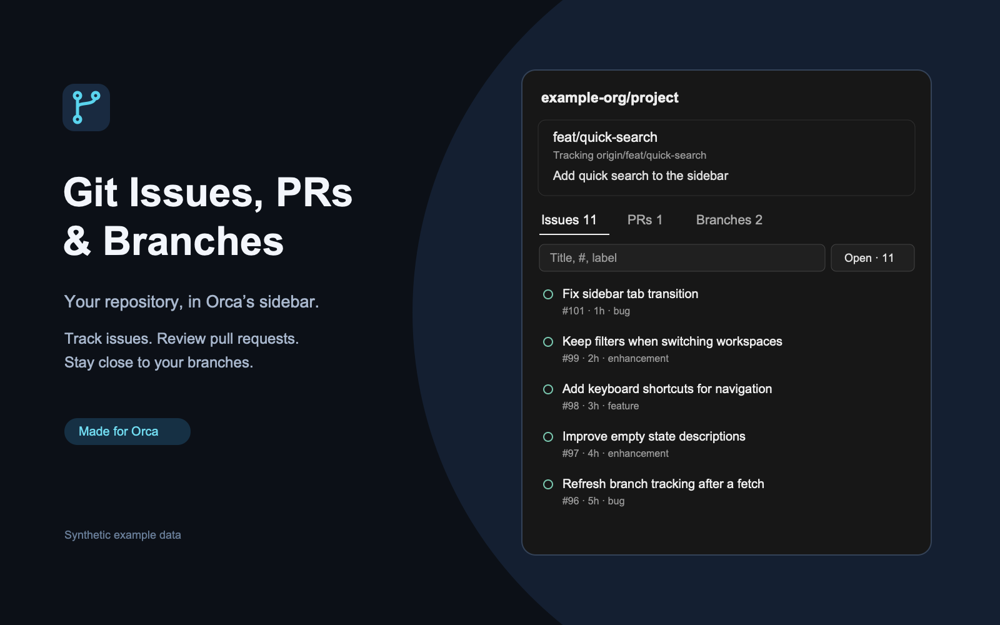
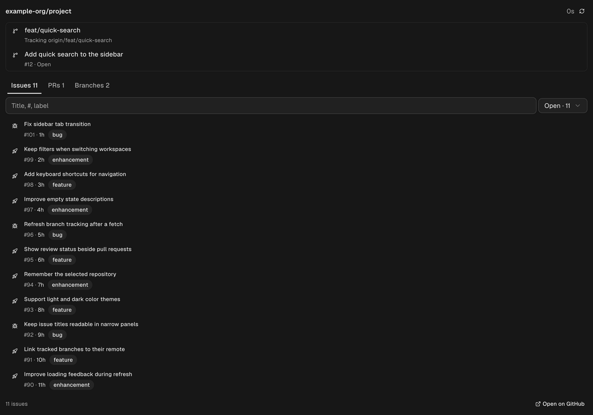

# Git Issues, PRs & Branches



An Orca sidebar plugin that displays GitHub issues, pull requests, and git branches for the currently active repository in Orca's right sidebar. Available on the [Orca Plugin Directory](https://www.onorca.dev/plugins/nhangen/orca-plugins).

## Overview



Screenshots use synthetic repository data and show only the plugin panel.

## Features

- **Current Branch Card**:
  - Shows the checked-out branch, its upstream, or that it is local only.
  - Links the branch's pull request (open first, else its latest merged or closed one), or offers to open one on GitHub.
- **GitHub Issues Tab**:
  - Automatically detects the GitHub repository slug (`owner/repo`) from the active workspace remote.
  - Queries GitHub issues via `gh` CLI (using existing authentication) or public GitHub REST API fallback.
  - One row of controls: a search box (title, `#number`, author, or label) beside an `Open` / `Closed` / `All` state menu.
  - Two-line rows: the title, then the number, relative updated time, labels, and comment count.
  - Clicking an issue's title or icon opens it in your default browser.
- **Pull Requests Tab**:
  - The same search box beside an `Open` / `Draft` / `Merged` / `Closed` / `All` state menu.
  - Shows the number, updated time, head and target branches (`branch → main`), and marks the PR for the current branch.
  - Clicking a pull request's title or icon opens it in your default browser.
- **Git Branches Tab**:
  - Shows all local branches, with the checked-out branch highlighted.
  - Marks each branch's pull request number and any branch that is local only, with its latest commit subject and date.
  - Real-time text search filter for quick branch lookups.
  - Clicking the name or icon of a branch pushed to `origin` opens it on GitHub; local-only branches have no page to open.
- **Errors and empty results**: a GitHub error shows a **Retry** button; a search with no matches offers **Clear filter**.
- **Auto-Syncing**:
  - Automatically updates when switching workspaces or worktrees in Orca (`workspace.changed` event).
  - Includes a manual refresh button in the header.

## Requirements & Setup

- **Orca**: Version `>= 1.4.248`.
- **Git**: Local `git` binary on PATH.
- **GitHub Authentication** (Optional but recommended):
  - For **public repositories**: The plugin queries GitHub's public REST API automatically without configuration.
  - For **private repositories**: Install the GitHub CLI (`gh`) and run `gh auth login`, or set `GITHUB_TOKEN` in your environment. The plugin worker automatically inherits your local `gh` authentication credentials.

## Installation

### From the Orca Marketplace / Catalog

1. In Orca, open **Settings** (`Cmd+,` or `Ctrl+,`) > **Plugins**.
2. Search for **Git Issues, PRs & Branches** (`nhangen.git-issues`).
3. Click **Install** and approve the required capabilities (`workspace:read`, `storage:own`).

### Manual / Development CLI Load

```sh
# Clone this repository
git clone https://github.com/nhangen/orca-plugins.git
cd orca-plugins

# Load as a local development plugin
orca plugin dev load ./plugins/git-issues
```

Or run with live reload during development:
```sh
orca plugin dev watch ./plugins/git-issues
```

## FAQ & Troubleshooting

### Why are issues or PRs not showing for my private repo?
Ensure the GitHub CLI is authenticated on your machine by running `gh auth status` in your terminal. Once authenticated, click the refresh button in the plugin header.

### Does this work with SSH remotes?
Yes. The plugin parses standard HTTPS remotes (`https://github.com/owner/repo.git`), standard SSH remotes (`git@github.com:owner/repo.git`), and custom SSH config host aliases (e.g. `github-nhangen:owner/repo.git`).

### What permissions does this plugin need?
- `workspace:read`: Used to read the active workspace directory path and branch name to query git status.
- `agent:read`: Used to correlate agent terminals with their workspace, which identifies the focused repo when several share a branch and name.
- `storage:own`: Used to cache repository issues and pull requests locally to minimize network latency and API requests.

As a trusted worker, the plugin also runs `git`, `gh`, and the Orca CLI (`orca terminal show`, `orca environment list`, `orca worktree ps`) directly. That last command returns terminal metadata and a preview of the terminal's output, which no declared capability covers; the plugin reads only `worktreePath` from it.

### Why does the panel show the wrong repo when several main clones are on `main`?
Orca's plugin API reports the focused workspace as `{branch, displayName}` only — no path or workspace id — and Orca names every root clone after its checked-out branch (`main`). When two or more local repositories sit on the same branch with the same name, the plugin cannot tell which one you focused, so the panel shows a **workspace picker at the top**. Choose your repo and the pick is remembered for that branch + name, across worker restarts.

Two signals identify the focused workspace exactly, in this order:

1. **Orca CLI join**: when the focus is ambiguous, the plugin runs the Orca app's own CLI, `orca terminal show --terminal=<id> --json`, for up to three of the focused workspace's terminals, and reads each terminal's `worktreePath`. For a terminal on a paired server, it retries with `--environment=<server>` for each environment in `orca environment list`. This is not a documented plugin contract, so any unexpected output counts as "no signal". The command also returns a preview of the terminal's output. The plugin parses it in memory and never logs or stores it. The join was verified on Orca 1.4.255 only; if an older build answers differently, the join finds nothing and the plugin falls back.
2. **Agent correlation**: `agent.status.changed` events tie terminal ids to workspace ids; a terminal that has reported status once pins its workspace.

Either signal resolves the focus with no picker. For an SSH or hosted workspace, the remote workspace's project name or the terminal's worktree path also names the repo. When no listed local workspace matches it, the plugin looks for a local clone with that folder name beside your known workspaces and under `~/code`, `~/Projects`, `~/src`, `~/dev`, `~/workspace`, `~/workspaces`, and `~/ML-AI`, and opens that clone directly.

Terminal titles and the one active remote worktree on the focused branch are weaker hints: any process can set a title, and a remote worktree is not tied to the workspace you focused. They only preselect a repo in the picker and never resolve the focus on their own.

When none of these applies, the panel falls back to a guess and keeps the picker up so you can correct it:

3. **Per-workspace locker**: the panel remembers, in a `persist: 'workspace'` atom that Orca keys per workspace, the path a focused terminal last identified or the repo you last picked there. Revisiting that workspace with no terminals open preselects it in the picker.
4. **Shared pick**: otherwise, the repo last picked for that branch + name.

The pick fallback is shared by every workspace with that branch and name: after you pick `claude-ceo`, focusing another `main`/`main` clone still shows `claude-ceo` until one of the signals above resolves it, or you pick again. The locker only covers workspaces you have visited with a terminal open or picked in. To make a clone resolve on its own without any signal, give its workspace a unique name in Orca; a unique name on the shared branch matches exactly and needs no picker.

### What if I rename a workspace later?
A renamed workspace with a unique name resolves directly. If the new name is shared too, the pick is keyed by the new branch + name, so pick again once.

### Does the panel see workspaces on remote hosts?
No. `workspace.list` spans every host Orca reaches, but the plugin only runs `git` and `gh` on this machine, so it ignores workspaces whose `hostId` names a remote host. Orca does not say which host the focused workspace is on, so focusing a remote workspace shows the local repo with the same branch or name. If no local repo matches, the panel says so and shows nothing.

## Architecture

This plugin uses the `worker-panel` pattern:

1. **Declarative TSX Panel (`src/panel.tsx`)**:
   - Runs in Orca's sandboxed components runtime (`"ui": "components"`).
   - Renders with Orca's native components (`Stack`, `Row`, `Box`, `Tabs`, `Tab`, `List`, `ListItem`, `Badge`, `Button`, `IconButton`, `Input`, `Select`, `RadioGroup`, `Callout`, `Skeleton`, `EmptyState`, `RelativeTime`).
   - Communicates with the background worker via typed RPC (`repo.getContext`).
2. **Node.js Worker (`src/worker.ts`)**:
   - Runs as an out-of-process process on the host (`trusted-worker`).
   - Uses `workspace:read` capability to resolve active workspace details (`workspace.readContext` and `workspace.list`).
   - Executes local Git and GitHub CLI commands to collect branches, issues, and PRs.
   - Caches state in `storage:own`.
3. **Type Protocol (`src/protocol.ts`)**:
   - Shared TypeScript contract declaring requests and events for type safety.

## Testing & Verification

```sh
# Validate manifest and permissions
orca plugin validate ./plugins/git-issues

# Run panel and worker test suite
orca plugin test ./plugins/git-issues

# Render dry-run component check
orca plugin check ./plugins/git-issues
```

## License

MIT © [nhangen](https://github.com/nhangen)
